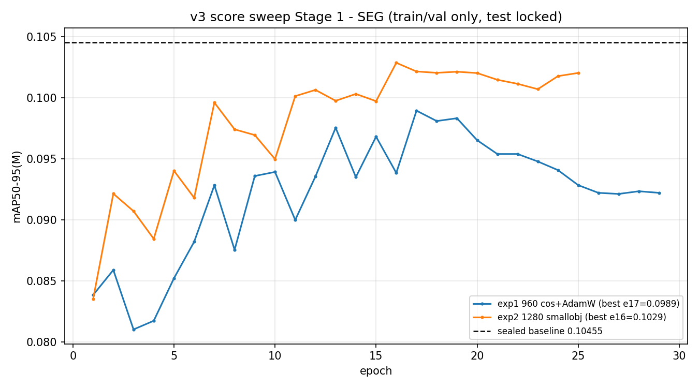
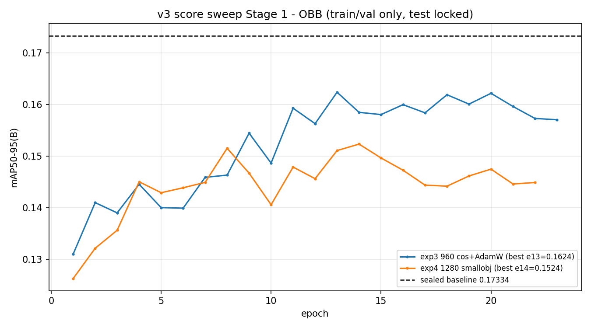

# v3 提分实验周报 — Stage 1 score sweep（2026-09-29 ~ 2026-10-03）

> 任务：在已封存 SEG/OBB 基线上完成 Stage 1 四组微调实验 + 分析复核，判定是否进入 Stage 2。
> **声明：全程 `test_used=false`，test 集始终锁定，仅使用 train/val。**

## 1. 实验完成度

Stage 1 四组实验**全部完成**（status=ok），自动分析与复核材料齐备：

| 实验 ID | 假设 | 状态 |
|---|---|---|
| v3_seg_ft_cos_adamw_960_e30 (exp1) | 低学习率 AdamW + cosine 在平台后细化边界 | ✅ ok |
| v3_seg_ft_smallobj_1280_e25 (exp2) | 1280 输入提升小目标类 | ✅ ok |
| v3_obb_ft_cos_adamw_960_e30 (exp3) | 低学习率 AdamW + cosine 细化旋转框回归 | ✅ ok |
| v3_obb_ft_smallobj_1280_e25 (exp4) | 1280 输入提升小目标类（OBB） | ✅ ok |

## 2. 环境与代码变更

- 代码基线：分支 `experiments/v3-score-sweep`，HEAD `5a94dd0`（领先 origin/main 四个提交：`9eafa77` workers 4→8、`f6f5ea5`/`855f776` 负责人 AI 输入流水线优化（已过评审）、`5a94dd0` device 修复）
- `5a94dd0`：修复 `resolve_device` 仅认单卡导致 OBB 实验在双卡实例 device=1 崩溃（infra bug，非参数变更；pytest 243 全过；崩溃现场封存 `runs/v3_obb_ft_cos_adamw_960_e30.aborted-dev1-20261001`）
- 环境：Python 3.10 / torch 2.9.0+cu128（sm_70 验证）/ ultralytics 8.4.90；每实验 manifest 含 commit、数据集 SHA-256、checkpoint 链
- 数据：OBB 门全量解码校验 + SEG 索引 preflight 两次全绿（82,096 条引用 0 缺失，SHA-256 一致，存档 `results/v3_score_sweep/preflight_*.json`）

## 3. 实验记录（任务书 2.5 全字段）

| 字段 | exp1 SEG 960 | exp2 SEG 1280 | exp3 OBB 960 | exp4 OBB 1280 |
|---|---|---|---|---|
| commit | 855f776 | 5a94dd0 | 5a94dd0 | 5a94dd0 |
| 起止 | 09-30 22:12 → 10-01 18:35 | 10-01 18:36 → 10-02 15:12 | 10-01 17:00 → 10-02 04:28 | 10-02 04:30 → 10-02 19:35 |
| epoch | 早停 29/30 | 25/25 | 早停 23/30 | 早停 22/25 |
| 最佳 epoch | 17 | 16 | 13 | 14 |
| 主指标（最佳） | 0.09895 | 0.10287 | 0.1624 | 0.15235 |
| FPS | 167.9 | 106.1 | 228.8 | 133.6 |
| 峰值显存 | 6.5G | 6.2G | 5.5G | 5.5G |
| 异常 | 无 | 无（1280 未 OOM） | device=1 崩溃 1 次（已修复留痕） | 无 |

（各实验均经历 1–2 次实例中断，全部从 checkpoint 无损续跑；详见第 7 节）

## 4. 自动分析结论（analyze 产物：summary.csv / analysis.md）

门槛：主指标 +0.002、FPS 降幅 ≤20%、单类 AP50-95 降幅 ≤0.02。

| 实验 | 主指标 | Δ vs 基线 | FPS 降幅 | 单类最差 | 自动判定 |
|---|---|---|---|---|---|
| exp1 | 0.09855 | -0.0060 | 27.9% | 无退化类 | reject_or_rework |
| exp2 | 0.10225 | -0.0023 | 54.5% | 维修痕迹 -0.055 | reject_or_rework |
| exp3 | 0.16225 | -0.0111 | 23.8% | 结构损伤 -0.036（共 3 类） | reject_or_rework |
| exp4 | 0.15232 | -0.0210 | 55.5% | 维修痕迹 -0.084（共 7 类） | reject_or_rework |

训练曲线（含封存基线参考线）：

## 5. 人工复核结论（两人复核：SEG 类 8/9/14；OBB 类 8/9/5 + 类 13）

### SEG 侧（复核类 8 胶衣脱落 / 9 胶衣裂纹 / 14 接闪器脱落）

**exp2（1280）在全部指定复核类上为正向**（vs 封存基线，mask AP50-95）：
类8 +0.0032、类9 +0.0102、类14 +0.0215；附带类5 +0.0199、类13 +0.0237。
预测实例数同步上升（326/206/223 vs exp1 的 282/186/208），1280 小目标假设在难检小类上有真实信号。
exp2 唯一退化类"维修痕迹"（-0.055）经全量 val 预测核实：**val 仅 66 实例**，bootstrap 95%CI 跨零，小样本波动可解释但未证实；误检去向主要是表面油污（外观相近类）。
exp1 复核类基本持平（±0.004 内），无单类退化。

### OBB 侧（复核类 8/9/5 + 低 recall 类 13）

基于全量 val 预测导出（7,244 图，只读推理）逐类核查：

- **exp3（960）**：类 13 结构损伤 -0.036 为表观最大退化，但该类 **val 仅 25 实例（分布于 22 张图像）**（exp3 仅预测出 5 个），退化幅度受小样本放大；误检去向为玻纤损伤×5、玻纤腐蚀×3（形态/层级相邻类），指向**标注边界问题**而非模型能力丧失。类 8/9 小负（-0.010/-0.014），类 5 持平（+0.001）。
- **exp4（1280）**：检出数全面上升（类 5：377→464、类 8：290→403、类 9：234→363）但 7 个腐蚀/外观类 AP50-95 退化（最差维修痕迹 -0.084，该类 val 亦仅 66 实例，同判小样本噪声）；模式为**检出增多、精度与旋转框定位质量下降**。类 13 recall 0.130→0.217（升）而 AP 微降，recall-AP 背离。

## 6. 门槛判定与参数建议

**判定：不进入 Stage 2，本轮四组参数均不采纳为生产更新**（自动判定四组 reject_or_rework，两人复核一致确认）。依据：

1. 主指标全部负增长（-0.002 ~ -0.021），无一达到 +0.002；
2. FPS 降幅全部超 20% 红线（23.8% ~ 55.5%）；
3. 单类退化均出现在 ≤167 实例的小类上（噪声放大），不改变主指标结论。

**后续方向建议**（供负责人决策，非本轮结论）：

- 1280 输入的正向信号**仅 SEG 侧成立**（复核类全正、mAP50/recall 超基线；OBB 侧 mAP50/recall 均低于基线，不成立），建议下一轮受控假设：混分辨率评估、类别重加权、或仅对小类启用高分辨率；
- 标注质量排查：维修痕迹（66 实例）、结构损伤（25 实例/22 图）及其与相邻类的边界（第二方复核：疑点存在但未坐实）；
- 30 epoch 微调预算 + 早停机制下 AdamW/cosine 未显增益，如再试需更长 schedule 或不同 lr 假设。

## 7. 事故、中断与恢复（算力风险评估参考）

| 时间 | 事件 | 影响 | 处置 |
|---|---|---|---|
| 10-01 16:14 | exp3 因 device=1 校验崩溃 | 门禁白跑 2.75h？否——缓存命中零重付 | 修复 commit 5a94dd0，现场封存 |
| 10-01 ~19:33 | 欠费停机 #1 | 0 成果损失 | 19:44 充值重启，checkpoint 续跑 |
| 10-02 ~07:30 | 欠费停机 #2 | 0 成果损失 | 08:44 重启，`@reboot` 全自动恢复 |
| 10-02 08:57 | 抢占式实例**释放** | 0 成果损失（释放前 3 分钟完成灾难备份） | 09:17 新实例 + 原数据盘 40 分钟重建 |
| 10-03 02:08 | 主动节省停机 | — | 16:49 重启续跑复核 |

保障机制：checkpoint 每 epoch 落盘、10 分钟备份循环至数据盘、里程碑守护（自动记录起止/OOM/死亡/预警）、
`@reboot` 一键恢复脚本、灾难恢复手册（`system_rebuild/DISASTER_RECOVERY.md`）。

## 8. 费用与算力建议

- 已发生：8C 旧实例约 2 天；16C 双卡抢占 ~35h × ¥18.5/h ≈ **¥650**（含中断损耗 ~4h）
- 剩余工作：复核收尾 + 周报 ≈ 2–3h（~¥50）
- **续租建议：不需要续租**。交付完成后释放实例；数据盘（500G，含数据集+全部实验备份）建议保留至负责人确认归档，此后可释放（数据集原件在 OSS bucket belong-temp）

## 9. 附：可复现性

- 配置：`configs/v3_score_sweep.yaml` + `results/v3_score_sweep/resolved_configs/`
- 每实验 manifest 含 dataset_manifest_sha256、parent_checkpoint、resumed_from 链
- 运维脚本与恢复手册：`/data/backup/system_rebuild/`
- 分支补丁备份：`/data/backup/v3_score_sweep_branch_patches_20261002.patch`
